<div align="center">


# IPTVMac

**A native IPTV player for Mac, Android phones and Android TV.**<br>
Xtream Codes and M3U, instant search, a built-in player with subtitles, Picture in Picture, catch-up and downloads.<br>
Free and open source. No accounts, no analytics.

<br>

[](https://github.com/Goelir/IPTVMac/releases/latest)
[](https://github.com/Goelir/IPTVMac/releases)
[](LICENSE)


[](https://github.com/Goelir/IPTVMac/stargazers)

[**Download for Mac**](https://github.com/Goelir/IPTVMac/releases/latest) &nbsp;|&nbsp; [**Android and Android TV (APK)**](https://github.com/Goelir/IPTVMac/releases/tag/android-v1.0.4) &nbsp;|&nbsp; [All downloads](https://goelir.github.io/IPTVMac/download/) &nbsp;|&nbsp; [Website](https://goelir.github.io/IPTVMac/) &nbsp;|&nbsp; [What's new](https://goelir.github.io/IPTVMac/changelog/) &nbsp;|&nbsp; [Install](#install) &nbsp;|&nbsp; [Features](#features) &nbsp;|&nbsp; [FAQ](#faq) &nbsp;|&nbsp; [עברית](README.he.md)

<br>

[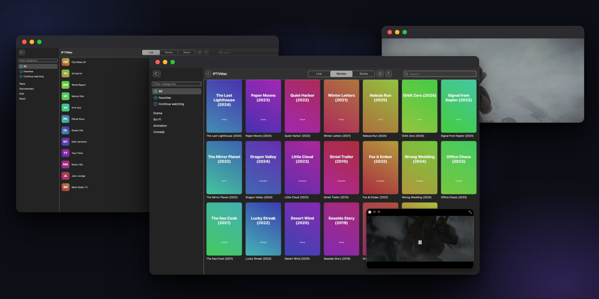](https://github.com/Goelir/IPTVMac/releases/download/v0.3.4/IPTVMac-demo-en.mp4)

<sub>Demo playlist with invented titles, video from the Blender Foundation's "Sintel" (CC-BY 3.0). [Watch the 80-second demo](https://github.com/Goelir/IPTVMac/releases/download/v0.3.4/IPTVMac-demo-en.mp4).</sub>

</div>

## Where it runs

| Device | Get it | Status | Written in |
|---|---|---|---|
| **Mac** (Apple Silicon, macOS 14+) | [DMG or one-line install](#install) | Released, signed and notarized, updates itself | Swift + SwiftUI |
| **Android phones and tablets** (Android 8+) | [APK on GitHub Releases](https://github.com/Goelir/IPTVMac/releases/tag/android-v1.0.4) (`arm64-v8a` for almost every phone) | Released, install by hand | Dart + Flutter, Kotlin layer |
| **Android TV, Google TV, Fire TV** | [32-bit or 64-bit APK](https://github.com/Goelir/IPTVMac/releases/tag/android-v1.0.4), installed with the Downloader app or a USB stick (see [Other platforms](#other-platforms)) | First version: remote control, no touch screen | Dart + Flutter, Kotlin layer |
| **iPhone and iPad** | Waiting for App Store review; [build from source](#other-platforms) meanwhile | Not released | Swift + SwiftUI |

The same engine, 31 languages and no-account design everywhere.

## Why IPTVMac

- **Fast.** Your whole library lives in a local SQLite database with full-text search. Typing finds a channel among 100,000 items in well under a second, in a category, in a section, or everywhere.
- **Stable.** Playback runs on [mpv](https://mpv.io) (libmpv, bundled). It plays the broken TS and HLS streams that trip up system players, reconnects when the stream drops, and uses hardware decoding.
- **Native, in the right language for each platform.** Swift and SwiftUI on Mac and iPhone; Dart with Flutter and a Kotlin layer on Android and Android TV. Each app is written for its own platform instead of one shared shell, and on every one the video is decoded by the same compiled libmpv engine; no Electron, no web view. Nothing else to install: the player is inside the app.
- **Open.** GPL-3.0, no accounts, no analytics. The app talks only to the servers you add, and to GitHub for updates.

## Install

**On Mac.** (Android and Android TV: see [Other platforms](#other-platforms).) Requires an Apple Silicon Mac (M1 or later) and macOS 14 or later.

**Install in one line.** Paste this in Terminal:

```
curl -fsSL https://raw.githubusercontent.com/Goelir/IPTVMac/main/install.sh | bash
```

It downloads the latest release, checks its signature and the SHA-256, copies IPTVMac to `/Applications` and opens it. [install.sh](install.sh) is short; read it first if you like. It works for every version, and because nothing is downloaded in a browser, macOS has nothing to flag. After this the app updates itself.

**Or download the DMG.** Get `IPTVMac.dmg` from the [latest release](https://github.com/Goelir/IPTVMac/releases/latest), open it and drag the **IPTVMac** icon onto the **Applications** icon in the window (not the .dmg file itself). From version 0.9.1, releases are signed with an Apple Developer ID and notarized (an automated malware scan by Apple, not a review of the app), so the app opens with a normal double-click. macOS may ask you once to confirm that it was downloaded from the internet.

Older versions are not notarized, and macOS blocks a browser-downloaded copy on first launch. For those:

- macOS 15 and later: try to open the app once, then go to **System Settings > Privacy & Security**, scroll down and click **Open Anyway** next to IPTVMac.
- Or in Terminal: `xattr -dr com.apple.quarantine /Applications/IPTVMac.app`

Prefer to see it first? [Watch the install guide (95 seconds)](https://youtu.be/TgaoFEEMg48).

## First run

The app opens a short three-step guide. You add a playlist from your provider:

- **Xtream Codes:** server address (for example `http://host:8080`), username and password. Your provider gives you these.
- **M3U:** a name and the playlist link.

IPTVMac is only a player. It does not include or host any channels, movies or series: you need a source you are allowed to use.

### No playlist yet?

If you do not have a provider, [iptv-org/iptv](https://github.com/iptv-org/iptv) is a free, independent open source project that publishes M3U playlists of publicly available channels from around the world. In IPTVMac choose **M3U**, give it a name and paste:

```
https://iptv-org.github.io/iptv/index.m3u
```

It holds about 11,000 entries (loading takes a moment); the project's README also lists playlists by country, language and category. IPTVMac is not affiliated with iptv-org. Whether a stream is available, and whether you may watch it, depends on the channel and on your country: use only what you are allowed to.

## Screenshots

<div align="center">

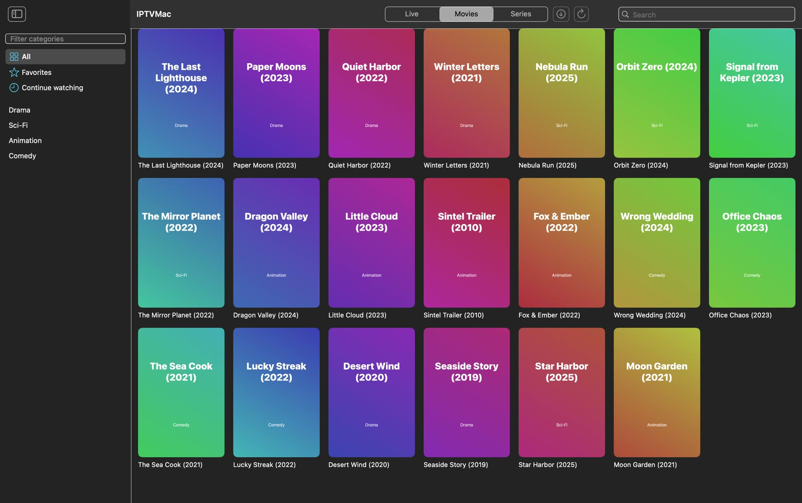

| | |
|:---:|:---:|
| 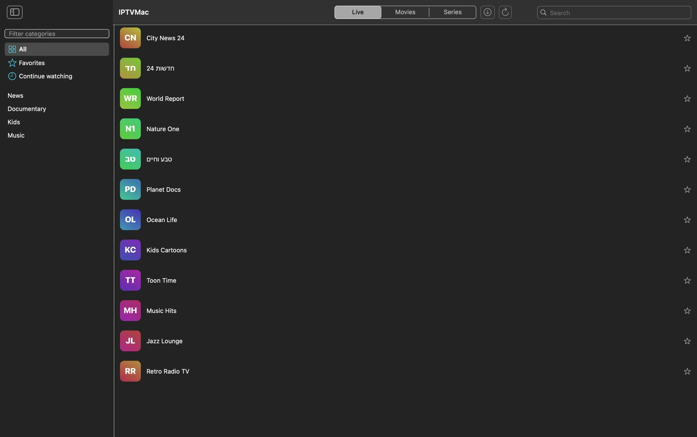<br>**Live channels** | 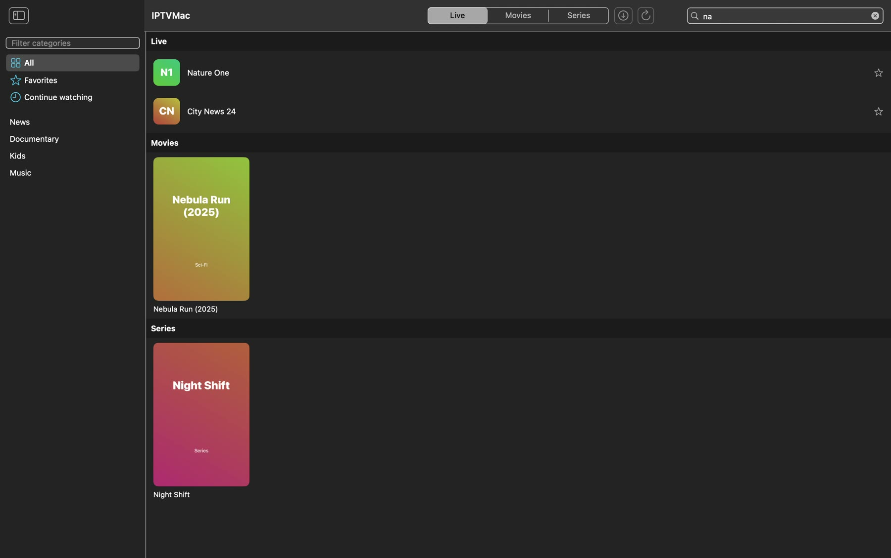<br>**Search everywhere** |
| 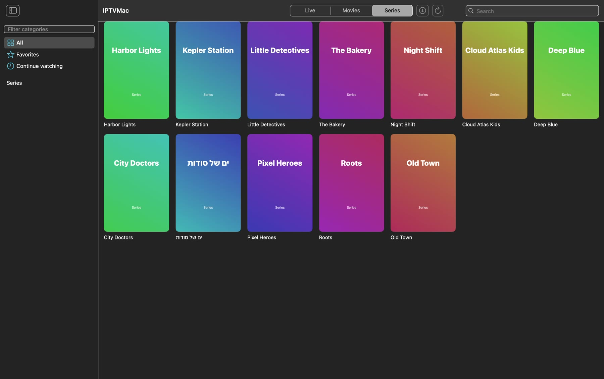<br>**Series** | <br>**Player** |
| 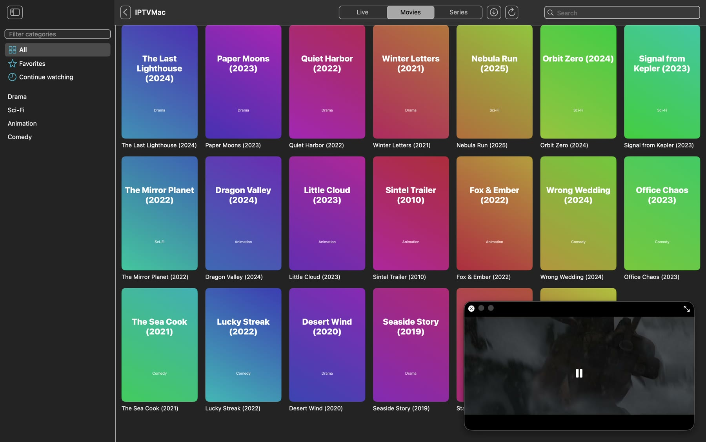<br>**Picture in Picture** | 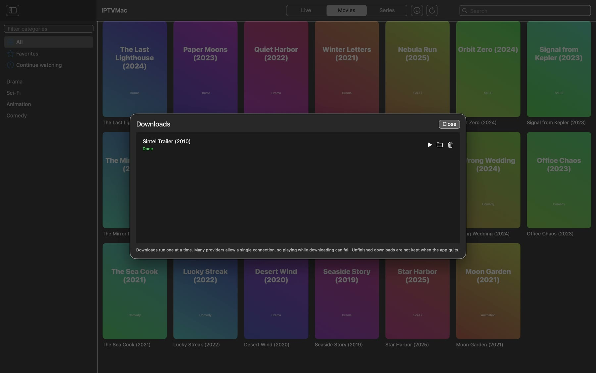<br>**Downloads** |

<sub>The screenshots use an invented demo playlist; the video is the Blender Foundation's "Sintel" trailer (CC-BY 3.0).</sub>

</div>

## Android and Android TV

<p align="center">
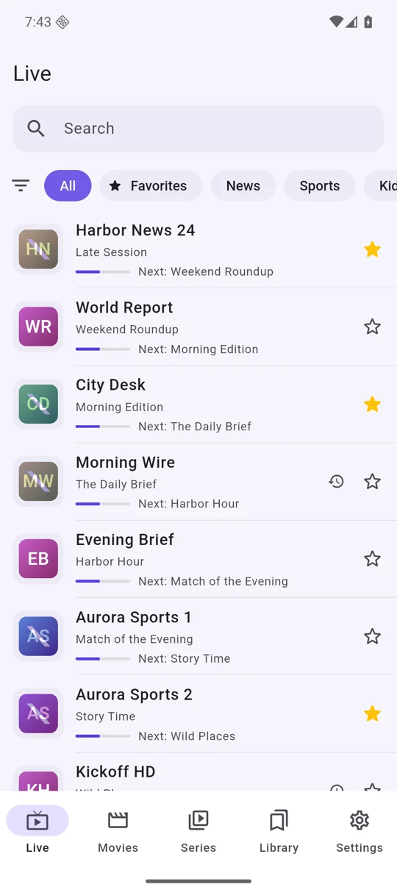
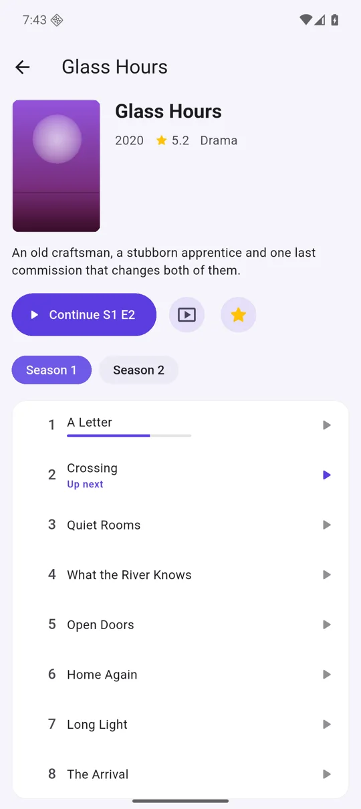
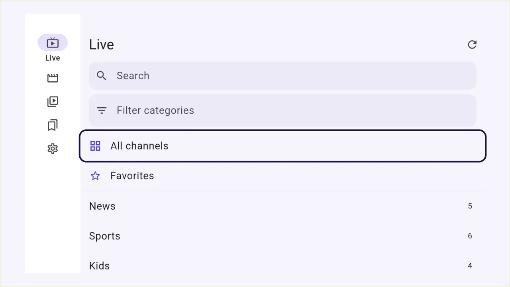
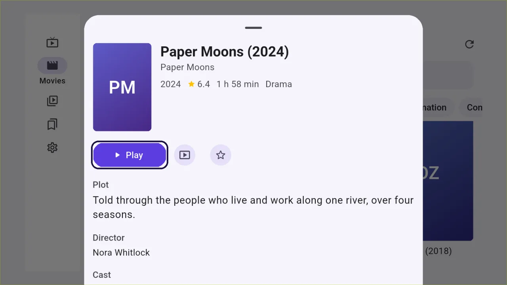
</p>

<sub>Demo playlist with invented titles. The two TV pictures come from an emulator.</sub>

**Phone or tablet (Android 8 or later).**

1. Download [IPTVMac-Android-1.0.4-arm64-v8a.apk](https://github.com/Goelir/IPTVMac/releases/download/android-v1.0.4/IPTVMac-Android-1.0.4-arm64-v8a.apk) (it suits almost every phone; the [release page](https://github.com/Goelir/IPTVMac/releases/tag/android-v1.0.4) lists the other files).
2. Open it and allow installs from your browser or Files app when Android asks.
3. Add your source. A banner tells you when a newer version is out; installing it stays manual.

**Android TV, Google TV and Fire TV.**

1. On the TV install the **Downloader** app (Fire TV: search "Downloader"; Android TV and Google TV: Google Play) and open it.
2. In Downloader type the address of the file: [32-bit](https://github.com/Goelir/IPTVMac/releases/download/android-v1.0.4/IPTVMac-Android-1.0.4-tv-32bit.apk) (try this first, it runs on almost every TV and box) or [64-bit](https://github.com/Goelir/IPTVMac/releases/download/android-v1.0.4/IPTVMac-Android-1.0.4-tv-64bit.apk) (if the TV says the app is not compatible). A USB stick with the file works too.
3. Allow Downloader to install apps when the TV asks, install, and open IPTVMac. With the remote: arrows move, OK selects, Back goes up one level, **hold Back to close the app**.

## Features

| | |
|---|---|
| **Live, Movies, Series** | Three sections with categories, posters, channel logos, "Continue watching" and favorites. |
| **Search** | Type to search inside the current category, inside the section, or everywhere, with results grouped by section. Hebrew, Arabic and Latin text. |
| **Player** | Full screen by default; controls fade until you move the mouse. Space, arrows to skip (10 s by default, 5 to 60 s in Settings), `F` full screen, `2` double speed, `[` and `]` slower and faster, a speed picker from 0.25x to 4x (movies and episodes), `A` fit, fill or stretch, a **sleep timer** (moon icon), an optional clock, `Esc` to go back. |
| **Subtitles and audio** | Embedded tracks, external `.srt` and `.ass` files (menu or drag and drop), size and delay settings, preferred languages. |
| **Picture in Picture** | A floating mini player, always on top, that follows you across Spaces while you keep browsing. |
| **Catch-up** | Watch past programs on channels whose provider supports it (Xtream `tv_archive`), picked from the EPG. |
| **EPG** | Current and next program in the channel list and in the player (Xtream). |
| **Downloads** | Save movies and episodes (a whole season at once on Xtream series) to a folder you choose, and play them from the Downloads screen. |
| **Playlists** | Xtream Codes and M3U. With several playlists, switch from the toolbar, or choose **All playlists** to search, favorite and continue watching across all of them, with the playlist name on every item. |
| **Resume and next episode** | Movies and episodes continue where you stopped. When an episode ends, the next one starts after a 5-second countdown (cancel it, or turn it off). |
| **Settings** | System, light or dark appearance, interface language, automatic playlist refresh, hide categories by words, network buffer size, **backup and restore** of playlists (without passwords), favorites and watch history, and clearing history, favorites or the image cache. |
| **31 languages** | Includes right-to-left layout for Hebrew, Arabic, Persian and Urdu. See [Languages](#languages). |
| **Signed self-updates** | The app checks for new releases, verifies a signature and a SHA-256, and updates itself. See [Updates](#updates). |

## FAQ

<details>
<summary><b>macOS says the app "cannot be opened" or "is damaged".</b></summary>

This happens with older versions, which are not notarized (see [Install](#install)). Install the latest release: the DMG, or the install command above, which works for every version. To open an old copy anyway, go to **System Settings > Privacy & Security** and click **Open Anyway**, or run `xattr -dr com.apple.quarantine /Applications/IPTVMac.app`. If you see this message on the latest release, please open an issue.
</details>

<details>
<summary><b>Nothing plays, or I see "HTTP 4xx/5xx" (for example 403 or 413).</b></summary>

Check the username and password in **Settings** (**Change password**). Some providers answer wrong credentials or a blocked connection with unusual HTTP codes, such as 403 or 413, instead of a clear message. A typo in the password is the most common cause. The player also shows the reason mpv reports.
</details>

<details>
<summary><b>The update fails with a message about GitHub limiting requests, or "HTTP 403".</b></summary>

Versions before 0.7.2 asked the GitHub API for the latest release, and GitHub allows only 60 such requests per hour for each IP address, so a shared network can hit the limit. Version 0.7.2 reads a signed `release.txt` from github.com instead, which has no such limit, and says clearly when GitHub is limiting a network. If an older version cannot update, download `IPTVMac.dmg` from the [latest release](https://github.com/Goelir/IPTVMac/releases/latest) and replace the app in `/Applications`, or run the install command above. From then on it updates by itself.
</details>

<details>
<summary><b>Playback fails while a download is running.</b></summary>

Many providers allow a single connection per account (see `max_connections` in your account). Downloads run one at a time; avoid watching something else while one runs. Using more connections would not make it faster either: the speed is limited by the provider's line.
</details>

<details>
<summary><b>Why is 2x speed not available on live channels?</b></summary>

A live stream cannot run faster than real time. Speed works on movies, episodes and catch-up.
</details>

<details>
<summary><b>Intel Macs or older macOS?</b></summary>

Not supported: the bundled player is built for Apple Silicon (arm64) and the app needs macOS 14 or later.
</details>

<details>
<summary><b>Where is my data?</b></summary>

In `~/Library/Application Support/IPTVMac/` (the folder and database are readable by your user only). See [Privacy](#privacy).
</details>

## Languages

31 interface languages: Hebrew, English, Arabic, Spanish, French, German, Portuguese, Italian, Russian, Ukrainian, Polish, Romanian, Bulgarian, Dutch, Swedish, Czech, Hungarian, Greek, Albanian, Turkish, Persian, Urdu, Hindi, Bengali, Indonesian, Vietnamese, Thai, Chinese (Simplified and Traditional), Japanese and Korean, with right-to-left layout for Hebrew, Arabic, Persian and Urdu. The app follows your Mac's language, or you can pick one in Settings.

Apart from Hebrew, English and Arabic, the translations were written with AI help and no native speaker has reviewed them yet. Corrections are welcome, see below.

### Contributing translations

1. Copy `Sources/IPTVMac/Resources/en.lproj/Localizable.strings` to `<lang>.lproj/` (an Apple language code such as `pt` or `zh-Hans`) and translate the values. Keep every key and every `%@` / `%d` placeholder, in the same order.
2. Add the language, written in its own language, to `InterfaceLanguage.all` in `Sources/IPTVMac/AppPrefs.swift` (this fills the language picker in Settings).
3. Run `python3 scripts/check-strings.py <lang>`; it must print `OK`.

## Updates

The installed app checks GitHub Releases at launch and every 6 hours. When a newer version exists it downloads it and verifies the release **signature** (an Ed25519 key that is not stored on GitHub and is pinned in the app) and the SHA-256 published in the release notes. Then it shows a banner: **Restart to update** (or it installs on the next quit). Automatic checking and automatic download can each be turned off in Settings.

## Privacy

Your sources are stored in `~/Library/Application Support/IPTVMac/` (readable by your user only). Account passwords are kept in that database in plain text; they are not in the Keychain (the Keychain asked for permission again with every new build). The app only contacts the servers you add, and GitHub for update checks. No analytics, no telemetry.

## Security

See [SECURITY.md](SECURITY.md) for how updates are protected, the known limits, and how to report a vulnerability privately.

## Other platforms

IPTVMac is a Mac app you can download today. Two more apps share its engine and its design, and their source is in this repository:

- **iPhone and iPad** (`ios/`): submitted to the App Store, waiting for review. Build with `scripts/ios-setup.sh`, then open `ios/IPTVPhone.xcodeproj` (see [ios/README.md](ios/README.md)).
- **Android** (`flutter/`): **[download the APK](https://github.com/Goelir/IPTVMac/releases/tag/android-v1.0.4)** (Android 8 or later; pick the `arm64-v8a` file for almost every phone, the release notes explain the install). Flutter and libmpv, 31 languages generated from the same strings. Touch player with gestures, Picture in Picture, sound that keeps playing with the screen off, a rotate button, and downloads of movies and episodes for offline viewing (the Android app is the one that has downloads next to the Mac app; the iPhone app does not). Build: `cd flutter && flutter pub get && flutter test && flutter build apk` (Flutter 3.47, JDK 17, Android SDK 36; see [flutter/PLAN.md](flutter/PLAN.md)). Android 8 or later. It tells you when a newer APK is out (a banner with a link to the release page; the install stays manual; it asks github.com at most every six hours, and Settings can switch that off).
- **Android TV, Google TV and Fire TV** (the same app; first TV version): download **[the 32-bit file](https://github.com/Goelir/IPTVMac/releases/download/android-v1.0.4/IPTVMac-Android-1.0.4-tv-32bit.apk)** (38 MB; it runs on almost every TV and box, including most Fire TV sticks) or, if the TV says it is not compatible, **[the 64-bit file](https://github.com/Goelir/IPTVMac/releases/download/android-v1.0.4/IPTVMac-Android-1.0.4-tv-64bit.apk)** (41 MB). On Fire TV or Android TV install it with the Downloader app (type the address of the file) or from a USB stick; there is no store listing yet. Use the remote: arrows move, OK selects, Back goes up one level, **holding Back closes the app**; in the player Left/Right seek, Up/Down change channel, OK pauses. No downloads on TV, and updates are manual (install the new file over the old one). Please report problems.

## Build from source

    brew install mpv pkgconf     # mpv only supplies the C headers to compile against
    scripts/swift.sh test        # tests
    scripts/swift.sh run IPTVMac # run
    scripts/make-dmg.sh          # builds build/IPTVMac.dmg

Use `scripts/swift.sh` instead of bare `swift` when only Command Line Tools are installed (it selects an SDK whose SwiftUI does not need Xcode's macro plugin). Design notes are in [docs/superpowers/specs](docs/superpowers/specs/2026-10-05-iptvmac-design.md).

## Guides

- [How to watch Xtream Codes IPTV on a Mac](https://goelir.github.io/IPTVMac/guides/xtream-codes-on-mac.html)
- [How to play an M3U playlist on a Mac](https://goelir.github.io/IPTVMac/guides/m3u-playlist-on-mac.html)
- [Picture in Picture for IPTV on a Mac](https://goelir.github.io/IPTVMac/guides/picture-in-picture-iptv-mac.html)

## Contributing

Bug reports, translations and pull requests are welcome; see [CONTRIBUTING.md](CONTRIBUTING.md). Never paste your server address, username or password in an issue.

## Third-party components

The release bundles prebuilt [libmpv](https://mpv.io) (mpv 0.36 built with `-Dgpl=false` and FFmpeg 6 configured with `--enable-version3` but not `--enable-gpl`, so the libraries are LGPL) from [media-kit/libmpv-darwin-build](https://github.com/media-kit/libmpv-darwin-build) v0.7.3 (sha256 `9bb168ec908b4801f4231f411e3278a0aea644a2b03ce375c880d2813ab7f949`). `scripts/make-app.sh` downloads and verifies it; source for those components is available from the projects linked above. Search and storage use [GRDB.swift](https://github.com/groue/GRDB.swift) (MIT). Demo footage: "Sintel" © Blender Foundation, [CC-BY 3.0](https://durian.blender.org).

## License

[GPL-3.0](LICENSE). IPTVMac is a media player and provides no content; you are responsible for using only sources you are authorized to access.
